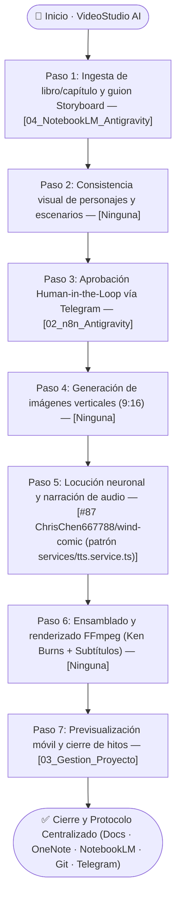
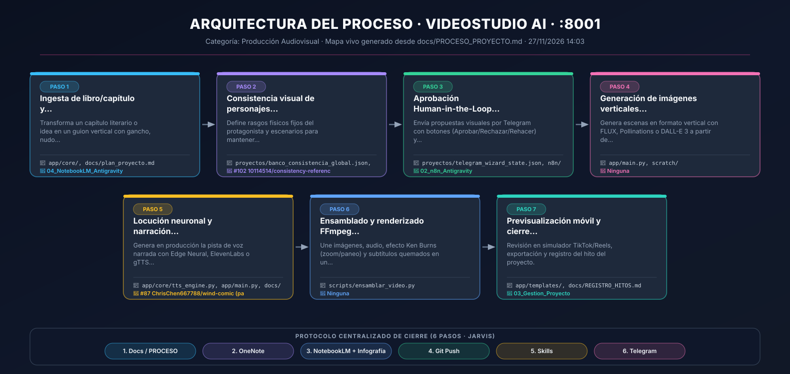

# Arquitectura del Proceso — VideoStudio AI

> Revisado automáticamente por el Protocolo Centralizado (JARVIS + NotebookLM).
> **Última revisión:** 27/11/2026 13:54 · **Categoría:** Producción Audiovisual · **Servicio:** Puerto `:8001` (http://localhost:8001) · **Avance:** 14/14 tareas.

## Esquema Visual del Proceso

## Desglose de Etapas, Componentes y Skills

| Paso | Descripción | Componentes / Archivos | Skills |
| :--- | :--- | :--- | :--- |
| **Paso 1: Ingesta de libro/capítulo y guion Storyboard** | Transforma un capítulo literario o idea en un guion vertical con gancho, nudo y desenlace optimizado para retención. | `app/core/, docs/plan_proyecto.md` | `04_NotebookLM_Antigravity` |
| **Paso 2: Consistencia visual de personajes y escenarios** | Define rasgos físicos fijos del protagonista y escenarios para mantener coherencia en todas las escenas del vídeo. | `proyectos/banco_consistencia_global.json, docs/ESTRATEGIA_CONSISTENCIA_VISUAL.md` | `Ninguna` |
| **Paso 3: Aprobación Human-in-the-Loop vía Telegram** | Envía propuestas visuales por Telegram con botones (Aprobar/Rechazar/Rehacer) y procesa respuestas en lenguaje natural. | `proyectos/telegram_wizard_state.json, n8n/workflows/` | `02_n8n_Antigravity` |
| **Paso 4: Generación de imágenes verticales (9:16)** | Genera escenas en formato vertical con FLUX, Pollinations o DALL-E 3 a partir de los prompts aprobados. | `app/main.py, scratch/` | `Ninguna` |
| **Paso 5: Locución neuronal y narración de audio** | Genera en producción la pista de voz narrada con Edge Neural, ElevenLabs o gTTS aplicando por defecto las 3 mejoras adoptadas de wind-comic (`services/tts.service.ts`): 1) modulación emocional por frase (velocidad y tono dinámicos), 2) voz diferenciada para narrador y personajes en diálogos, y 3) timestamps exactos por frase (`.sentences.json`) y por palabra (`.words.json`) para subtítulos sincronizados. | `app/core/tts_engine.py, app/main.py, docs/ESTRATEGIA_VOCES_NARRACION.md, validacion/pruebas_skills/P1/` | `#87 ChrisChen667788/wind-comic (patrón services/tts.service.ts)` |
| **Paso 6: Ensamblado y renderizado FFmpeg (Ken Burns + Subtítulos)** | Une imágenes, audio, efecto Ken Burns (zoom/paneo) y subtítulos quemados en un MP4 final 1080x1920. | `scripts/ensamblar_video.py` | `Ninguna` |
| **Paso 7: Previsualización móvil y cierre de hitos** | Revisión en simulador TikTok/Reels, exportación y registro del hito del proyecto. | `app/templates/, docs/REGISTRO_HITOS.md` | `03_Gestion_Proyecto` |

## Infografía / Esquema Gráfico (NotebookLM)

<!-- NOTAS_MANUALES_ARQUITECTURA -->
## Notas de Arquitectura y Decisiones

- Este documento se regenera desde `docs/PROCESO_PROYECTO.md` en cada cierre de tarea y se sincroniza con el cuaderno de NotebookLM del proyecto.
